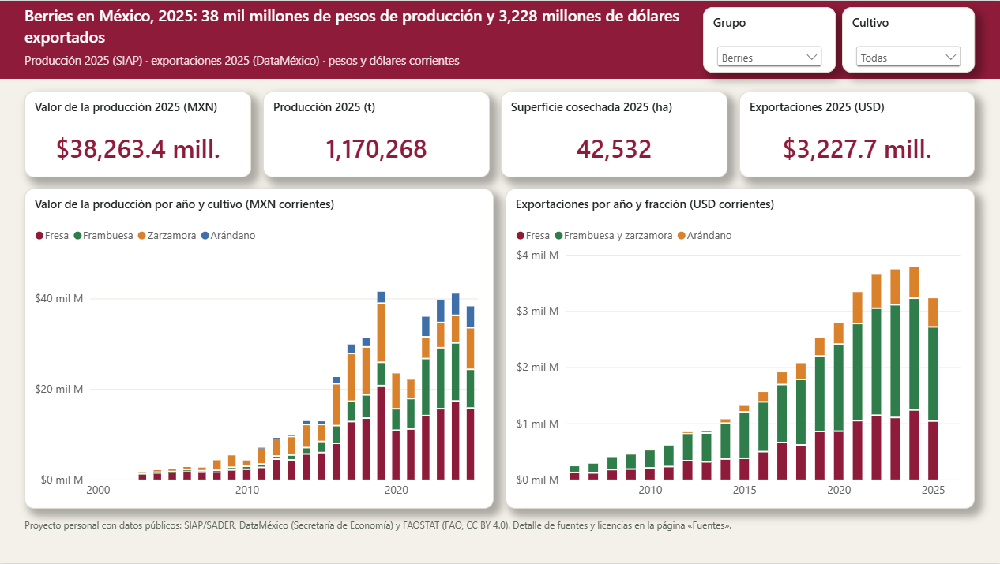
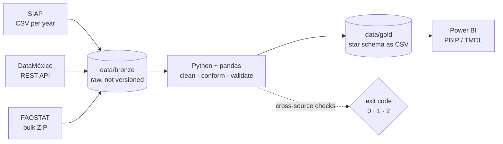

# Mexican Berries — a public-data pipeline and Power BI report

> **Where are Mexico's berries grown, how much is exported, and how do they compare with
> tomato, potato and corn?** An end-to-end pipeline that pulls three public sources,
> validates each one against an independent source, and feeds a star-schema Power BI model.


<!-- TODO: add the screenshot (1600 px wide) -->

**Highlights (2025 unless noted)**

- Michoacán grows **~60 %** of Mexico's strawberries; Sinaloa ranks **2nd** in blueberries.
- Berry exports grew **13.7×** since 2006, and **97 %** go to the United States.
- Mexico is the world's **2nd** raspberry producer (FAO 2024).
- One hectare of berries is worth **~47×** one hectare of grain corn.

## Architecture



- **Extract**: one module per source in `src/`, with retries and back-off (DataMéxico's
  server is slow and unstable). Raw downloads land in `data/bronze/` untouched.
- **Transform**: conformed dimensions (`dim_cultivo` maps SIAP crop ids, HS6 trade codes
  and FAO items to the same crop), facts at their natural grain.
- **Validate**: every source is checked against a *different* source, not against itself.
- **Serve**: `data/gold/` is versioned (14 MB, public data) so anyone can open the report
  without running the ETL.

## Data model

Three fact tables, nine dimensions, all relationships many-to-one in a single direction.

| Fact | Grain | Rows | Source |
|---|---|---|---|
| `fact_produccion` | municipality × crop × cycle × irrigation × year, 2003-2025 | 160,584 | SIAP |
| `fact_comercio` | month × HS6 × flow × country, 2006-01 to 2026-07 | 10,547 | DataMéxico |
| `fact_produccion_mundial` | country × crop × year, 1961-2024 | 37,013 | FAOSTAT |

Dimensions: `dim_fecha` (marked date table), `dim_cultivo`, `dim_hs6`, `dim_municipio`,
`dim_ciclo`, `dim_modalidad`, `dim_pais`, `dim_pais_comercio`, `dim_flujo`.
The model has 40 measures in display folders, `es-MX` culture and auto date/time off.

## Run it

```bash
python -m venv .venv && .venv\Scripts\activate      # Windows
pip install -r requirements.txt
python scripts/run_all.py --sin-banxico              # rebuilds data/gold from scratch
```

Exit codes: **0** all good · **1** a source could not be downloaded · **2** data is there but
a cross-source check failed.

Then open `powerbi/Berries.pbip` in Power BI Desktop and set the **RutaDatos** parameter
(*Transform data → Edit parameters*) to the full path of your `data/gold/` folder,
ending in a backslash.

## Validation

| Check | Result |
|---|---|
| SIAP vs. FAOSTAT, Mexico production per crop and year (2003-2024), 5 % tolerance | Equal to the unit except for point revisions (strawberry 2003: 2.9 %) |
| SIAP tomato + green tomato vs. FAO "Tomatoes" | Equal to the unit, 22 years |
| DataMéxico months × countries vs. the cube's own yearly total | 118 of 119 combinations match; the one that doesn't is declared with its exact amount |

Known gaps are **declared, not filled**: SIAP's open CSV for 2020 and 2021 publishes only ~80
crops (vs. ~300) and omits blueberries.

## Problems I solved

1. **Same crop id, different unit.** Since 2019 SIAP files strawberry *nursery plants* under
   the fruit's crop id with unit "Plant". Without filtering on `Nomunidad = Tonelada`, 2025
   strawberry production reads 61.6 million instead of 641,897 t.
2. **China counted twice.** FAOSTAT publishes "China" (area 351) *and* its parts (mainland,
   Taiwan, Hong Kong, Macao). Keeping both inflated the world total and pushed Mexico from
   4th to 5th in strawberries.
3. **An API that fails with HTTP 200.** DataMéxico answers `200 OK` with the text
   *"Cut member not found"* when a code doesn't exist. The client turns that into an error
   instead of silently loading nothing.
4. **Headers that change by year.** SIAP renames columns (`Precio` in 2003-2020,
   `Nomcultivo Sin Um` in 2015-2020) and some years use thousands separators. Files are read
   as text and converted explicitly.
5. **Year-over-year against an incomplete year.** `DATEADD(…, -1, YEAR)` compared
   January-July 2026 with all of 2025, so exports looked like they were falling. The prior
   period is trimmed to the last published month: blueberry exports actually **rise 12.8 %**.
6. **Different keys for the same crop.** Trade data hangs from HS6 codes, not from crops, and
   one code (0810.20) mixes raspberry and blackberry. `TREATAS` lets the crop slicer filter
   trade too, and the titles say "raspberry and blackberry" when that code is shown.

## Data sources and licenses

| Source | What | License |
|---|---|---|
| [SIAP / SADER](https://nube.agricultura.gob.mx/datosAbiertos/Agricola.php) | Crop production by municipality | Published as open government data; license **pending confirmation** |
| [DataMéxico / Secretaría de Economía](https://www.economia.gob.mx/datamexico/) | Foreign trade by HS6 and country (USD) | Published as open government data; license **pending confirmation** |
| [FAOSTAT QCL](https://www.fao.org/faostat/) | World production | **CC BY 4.0** — Source: FAO. FAOSTAT, Crops and livestock products. Last updated 2025-12-31 |

Details, URLs and verification notes: [`docs/fuentes.md`](docs/fuentes.md) (Spanish).
This is a non-commercial portfolio project and is not endorsed by any of these institutions.

## Roadmap

- [ ] Automated tests (`pytest`) for each problem above, run by GitHub Actions
- [ ] Docker image that rebuilds `data/gold/`
- [ ] Transformations in **dbt + DuckDB**, with dbt tests replacing the hand-written checks
- [ ] Orchestration with Dagster and a scheduled monthly refresh
- [ ] Exchange rate (Banxico SIE) and U.S. terminal-market prices (USDA AMS Market News)

## Repository layout

```
src/        one extractor per source + shared helpers
scripts/    run_all.py (ETL + checks), generar_informe.py (writes the PBIR report pages)
data/gold/  star schema as CSV (versioned)
powerbi/    Power BI project (PBIP, TMDL)
docs/       sources, licenses, plan
```

Code and comments are in Spanish; this README is in English.

## License

Code: [MIT](LICENSE). Data: each source under its own terms (see above).
